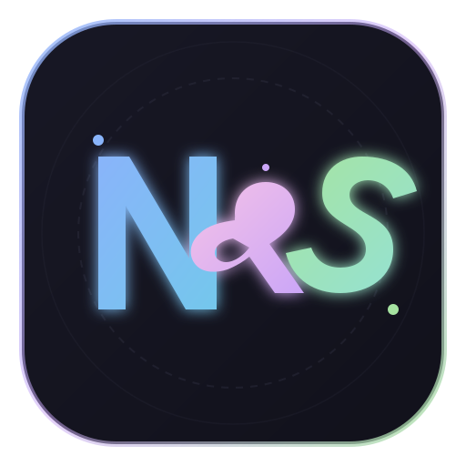

# N&S (Nova Script)

<div align="center">
  
  <h3>Высокопроизводительный, модульный язык программирования на Rust</h3>
  <p>
    <b>N&S (Nova Script)</b> — современный язык общего назначения с динамической типизацией, легковесным рантаймом, встроенным 2D-движком HTML5 Canvas, HTTP-сервером и интеграцией с языком GrassGreen.
  </p>
</div>

---

## Особенности языка

* **Высокая скорость**: Ядро полностью переписано с Python на **Rust** с нулевыми накладными расходами.
* **Zero-Config Toolchain**: Один бинарник `ns.exe` содержит интерпретатор, REPL, LSP-сервер и установщик расширения для VS Code.
* **Встроенный Web & 2D GameDev**:
  * Модуль `web`: встроенный HTTP-сервер, маршрутизация (`GET`, `POST`), работа с JSON и генератор HTML-страниц.
  * Модуль `game2d`: браузерный 2D-движок на базе HTML5 Canvas со спрайтами, игровым циклом 60 FPS и считыванием ввода клавиатуры/мыши через локальный сервер.
* **GrassGreen FFI (extern "grass")**: Прямое встраивание и выполнение кода компилятора [GrassGreen](https://grassgreen.info) прямо из скриптов `.ns`.
* **Обратная совместимость**: Полная поддержка старых скриптов `.nova` и функций раннего прототипа NovaScript.
* **Поддержка VS Code из коробки**: Команда `ns setup-vscode` активирует подсветку, автозакрытие скобок и сниппеты без публикации в Marketplace.

---

## Быстрый старт

### Требования
* Rust 1.75+ (для самостоятельной сборки из исходников)
* Windows 10/11, Linux или macOS

### Установка через готовый установщик Windows
Для пользователей Windows доступен готовый мастер установки:
* Запустите файл `installer/setup.exe`
* Установщик автоматически добавит `ns.exe` в системную переменную `PATH`, зарегистрирует расширения файлов `.ns` и `.nova` с фирменной иконкой в Проводнике и предложит настроить расширение для VS Code.

### Сборка из исходников
```bash
# Клонирование репозитория
git clone https://github.com/m1oky/NovaScript.git
cd NovaScript

# Сборка оптимизированного релиза
cargo build --release

# Регистрация иконки и ассоциаций файлов в Проводнике Windows
./target/release/ns register

# Установка расширения подсветки синтаксиса для VS Code
./target/release/ns setup-vscode
```

---

## Использование CLI-утилиты `ns`

| Команда | Описание |
| :--- | :--- |
| `ns` или `ns repl` | Запуск интерактивной консоли REPL с поддержкой многострочных блоков `{}` |
| `ns <файл.ns>` или `ns run <файл.ns>` | Выполнение скрипта на языке N&S (поддерживаются расширения `.ns` и `.nova`) |
| `ns -e "<code>"` | Быстрое выполнение однострочного кода (inline evaluation) |
| `ns init <имя_проекта>` | Создание шаблона нового проекта (`src/main.ns`, `.gitignore`, `README.md`) |
| `ns register` | Регистрация ассоциаций файлов `.ns` и `.nova` и иконки N&S в Проводнике Windows |
| `ns setup-vscode` | Автоматическая установка расширения в `%USERPROFILE%\.vscode\extensions\` |
| `ns lsp` | Запуск Language Server Protocol через стандартные потоки ввода/вывода (stdio) |

---

## Документация

Полная техническая документация на русском языке находится в папке [`docs/`](docs/README.md):

* [docs/README.md](docs/README.md) — Главная страница документации, архитектура и быстрый старт
* [docs/syntax.md](docs/syntax.md) — Полный справочник по синтаксису, типам данных, операторам и функциям
* [docs/modules-and-grassgreen.md](docs/modules-and-grassgreen.md) — Система модулей, инструкция `import` и интеграция с языком GrassGreen (FFI)
* [docs/stdlib-core.md](docs/stdlib-core.md) — Глобальные функции и модули ядра: `io`, `math`, `cli`
* [docs/stdlib-web.md](docs/stdlib-web.md) — Встроенный HTTP-сервер, маршрутизация, работа с JSON и генерация HTML
* [docs/stdlib-game2d.md](docs/stdlib-game2d.md) — 2D Canvas движок в браузере с поддержкой 60 FPS и клавиатуры/мыши
* [docs/cli-and-tooling.md](docs/cli-and-tooling.md) — Все команды CLI `ns`, интерактивный REPL, LSP-сервер и расширение VS Code

---

## Справочник по синтаксису

### 1. Переменные и типы данных
Объявление переменных выполняется с помощью ключевого слова `let`. Поддерживаются типы: `Int`, `Float`, `String`, `Bool`, `Array`, `Map`, `Null`:
```javascript
let name = "NovaScript"      // Строка (String)
let version = 1.0            // Число с плавающей точкой (Float)
let count = 42               // Целое число (Int)
let is_active = true         // Логический тип (Bool)
let items = ["web", "game"]  // Массив (Array)
let user = {                 // Объект / Словарь (Map)
    login: "m1oky",
    role: "admin"
}
```

### 2. Управляющие конструкции
```javascript
// Условный оператор if / else
if count > 10 {
    print("Большое число!")
} else {
    print("Малое число.")
}

// Цикл while
let i = 0
while i < 3 {
    print("Итерация: " + i)
    i = i + 1
}

// Цикл for..in
for item in items {
    print("Модуль: " + item)
}
```

### 3. Пользовательские функции
```javascript
func add(a, b) {
    return a + b
}

func greet(user) {
    print("Привет, " + user + "!")
}

let sum = add(10, 25)
greet("Разработчик")
```

---

## Стандартная библиотека модулей

### Модуль `cli` (Терминал и стилизация)
```javascript
import "cli"

print(cli.bold(cli.green("[OK] Успешная операция!")))
print(cli.red("[Error] Критическая ошибка"))
print(cli.cyan("[Info] Информация"))

// Аргументы командной строки
let args = cli.args()
```

### Модуль `math` (Математика)
```javascript
import "math"

let root = math.sqrt(144)        // 12
let dice = math.random(1, 6)     // Случайное число от 1 до 6
let angle = math.sin(math.PI / 2)// 1.0
```

### Модуль `web` (HTTP-сервер и генерация веб-страниц)
```javascript
import "web"

web.get("/", func(req) {
    return web.html("Главная страница", "<h1>Добро пожаловать в N&S Web!</h1>")
})

web.get("/api/user", func(req) {
    return { id: 1, name: "Alice", active: true }
})

// Запуск веб-сервера на порту 8080
web.server(8080)
```

### Модуль `game2d` (HTML5 Canvas 2D-движок)
Запускает браузер с `<canvas>` и связывает физику и рендеринг со скоростью 60 FPS через фоновый сервер:
```javascript
import "game2d"

let x = 100
let y = 100
let speed = 200

// Открывает окно браузера и запускает сервер на 127.0.0.1:8090
game2d.window(800, 600, "Моя 2D Игра")

game2d.on_update(func(dt) {
    if game2d.key_down("KeyD") { x = x + speed * dt }
    if game2d.key_down("KeyA") { x = x - speed * dt }
})

game2d.on_draw(func() {
    game2d.clear("#11111b")
    game2d.rect(x, y, 40, 40, "#89b4fa")
    game2d.circle(game2d.mouse_x(), game2d.mouse_y(), 10, "#a6e3a1")
})

game2d.start()
```

---

## Интеграция с языком GrassGreen (extern "grass")

N&S поддерживает прямое взаимодействие с системным компилятором [GrassGreen](https://grassgreen.info):

### 1. Встраивание кода через `extern "grass"`:
```javascript
print("[Info] Вызов ядра GrassGreen:")

extern "grass" {
    take user = "Developer";
    gout << "[GrassGreen Core] Output from native compiler, " << user << "!" << endl;
}
```

### 2. Импорт модулей `.grass`:
```javascript
import grass "./logic.grass" as my_module

if my_module.available {
    my_module.run()
}
```
*Примечание:* Если GrassGreen не установлен на ПК пользователя, N&S выведет предупреждение со ссылкой на [grassgreen.info](https://grassgreen.info) без падения основного процесса.

---

## Сборка Windows-установщика (setup.exe)

В директории `installer/` подготовлен скрипт `setup.iss` для **Inno Setup 6**:
1. Откройте `installer/setup.iss` в Inno Setup Compiler.
2. Нажмите **Build** -> **Compile**.
3. Готовый файл `setup.exe` автоматически:
   * Установит `ns.exe` в `{autopf}\N&S`.
   * Добавит путь в системную переменную `PATH`.
   * Зарегистрирует ассоциации файлов `.ns` и `.nova` с иконкой `icon.ico`.
   * Предложит чекбокс установки расширения в VS Code.
   * Не создаёт лишних bat-скриптов и ярлыков на Рабочем столе.

---

## Лицензия
Проект распространяется под открытой лицензией [MIT](LICENSE).
Авторы: **Pyfik228901**, **m1oky** (2026).
